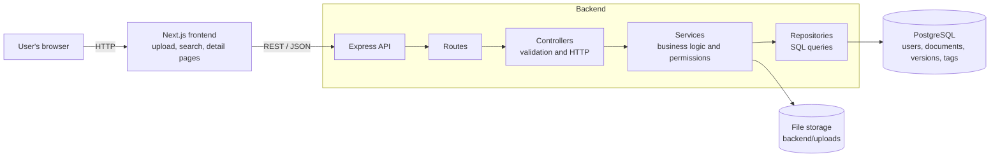

# Document Repository

A proof of concept for a document repository where employees can upload, store and search corporate documents. Each document has metadata (title, tags, and an optional department restriction) and a full version history: uploading a new version makes it the current one, but older versions are kept and can still be downloaded. The backend is a layered Node.js (Express) REST API on top of PostgreSQL, and the frontend is a Next.js (App Router) app with an upload form, a search page and a document detail page. PostgreSQL runs through Docker Compose.

## A note on AI assistance

I built this project step by step with the help of an AI assistant (Claude), which I used for planning, writing code and documentation, and explaining concepts. I ran and tested every step myself (API calls with Postman, the UI in the browser, and checks directly in the database), and I'm happy to walk through any part of the code.

## Features

- Upload a document with a title, tags and an optional department restriction
- Search by title, tag and uploader (filters can be combined), with pagination
- Document detail page: metadata, tags, visibility, current version, full version history
- Download the latest version or any older version (original file name is kept)
- Upload a new version of an existing document (history is kept)
- Department-based permissions, enforced on the server for search, detail, download and new versions
- Validation on both the API and the forms, with proper HTTP status codes

## Tech stack

| Layer | Technology |
|---|---|
| Backend | Node.js, Express (plain JavaScript), `pg`, `multer` |
| Frontend | Next.js 16 (App Router), React, Tailwind CSS |
| Database | PostgreSQL 16 (raw SQL, no ORM) |
| DevOps | Docker Compose (PostgreSQL), Git/GitHub |

## Architecture



The full design write-up is in [docs/architecture.md](docs/architecture.md) and the database design (ER diagram, tables, indexes) is in [docs/database.md](docs/database.md).

## How to run it locally

### Prerequisites

- **Node.js 20.9 or newer** (required by Next.js 16). I developed and tested with Node.js **X.Y.Z** <!-- replace with the output of `node -v` -->
- Docker Desktop (for PostgreSQL)
- Git

### 1. Start the database

From the repository root:

```bash
docker compose up -d
```

On the first start PostgreSQL runs `db/schema.sql` and `db/seed.sql`, which create the tables, the indexes and five demo users.

### 2. Start the backend (port 4000)

```bash
cd backend
npm install
cp .env.example .env
npm run dev
```

Check it at http://localhost:4000/health. It should report `"database":"connected"`.

### 3. Start the frontend (port 3000)

In a second terminal:

```bash
cd frontend
npm install
npm run dev
```

Then open **http://localhost:3000**.

### Demo users

There is no real login. Use the **"Acting as"** dropdown in the navigation bar to choose who you are.

| Name | Department | Role |
|---|---|---|
| Amr Hassan | IT | admin |
| Sara Ali | Finance | employee |
| Omar Khaled | Finance | employee |
| Nour Samir | Legal | employee |
| Youssef Adel | IT | employee |

Admins can see every document. Other users see public documents and documents restricted to their own department.

### Resetting everything

```bash
docker compose down -v
docker compose up -d
```

`-v` deletes the database volume, so the schema and seed run again. Also delete the files inside `backend/uploads/` so the disk matches the empty database.

## API overview

All endpoints except `/health` and `GET /api/users` need an `x-user-id` header with the id of the current user.

| Method | Endpoint | Description |
|---|---|---|
| GET | `/health` | Health check, including the database connection |
| GET | `/api/users` | List users (used for the "Acting as" dropdown) |
| GET | `/api/users/me` | The current user |
| POST | `/api/documents` | Upload a document (`multipart/form-data`: `file`, `title`, `tags`, `allowedDepartment`) |
| GET | `/api/documents` | Search (`title`, `tag`, `uploader`, `page`, `limit`), filtered by permissions |
| GET | `/api/documents/:id` | Document metadata, tags and all versions |
| GET | `/api/documents/:id/versions` | Version history |
| GET | `/api/documents/:id/download` | Download a file (`?version=N`, latest by default) |
| POST | `/api/documents/:id/versions` | Upload a new version (`multipart/form-data`: `file`) |

### Validation and errors

Errors are returned as `{ "error": "message" }` with a sensible status code:

| Status | When |
|---|---|
| 400 | Missing title or file, disallowed file type, too many or too long tags, invalid id or query parameter |
| 401 | Missing or unknown `x-user-id` |
| 403 | The document is restricted to another department |
| 404 | Unknown document or version, or unknown route |
| 413 | File larger than 10 MB |
| 500 | Unexpected error (details are logged on the server, not sent to the client) |

Allowed file types: PDF, DOCX, XLSX, TXT, PNG, JPG (max 10 MB).

## Project structure

```
.
├── docker-compose.yml        PostgreSQL service
├── db/
│   ├── schema.sql            tables, constraints, indexes
│   └── seed.sql              demo users and starter tags
├── docs/
│   ├── architecture.md       architecture diagram and design choices
│   └── database.md           ER diagram and schema notes
├── backend/src/
│   ├── routes/               URL -> controller mapping
│   ├── controllers/          HTTP handling
│   ├── validators/           input validation
│   ├── services/             business logic and permission checks
│   ├── repositories/         all SQL queries
│   ├── middleware/           current user, file upload, error handling
│   ├── db/                   connection pool and transaction helper
│   └── utils/                AppError
└── frontend/src/
    ├── app/                  pages: /, /upload, /search, /documents/[id]
    ├── components/           navigation bar, user provider
    └── lib/                  API helper, formatting, file rules
```

## Design decisions and assumptions

- **Layers:** routes, controllers, services and repositories are separate, and all SQL lives in the repositories.
- **Versions:** each upload is a new row in `document_versions`. The current version is the one with the highest `version_number`, so nothing is ever overwritten. Two simultaneous uploads to the same document are handled by locking the document row inside a transaction.
- **Transactions:** creating a document inserts the document, its first version and its tags in one transaction, so a failure never leaves partial data.
- **Permissions:** a document has an optional `allowed_department` (empty means everyone). The check is in the SQL for search and in the service for single-document requests, and admins see everything.
- **Files:** files are stored on the local disk in `backend/uploads/` under random names, and the database stores the path and the original file name. Downloads use the original name.
- **Authentication:** there is no real login. The frontend sends the chosen user's id in the `x-user-id` header and the server loads that user. This keeps the proof of concept simple, but it is not secure, because anyone can send any id.
- **Restriction:** a document can be restricted to **one** department or to everyone, not to several departments at once. Tags are unlimited (up to 10 per document).
- **Departments** are plain text, and comparisons are case-insensitive.

## Beyond the requirements

- Clickable tag chips that filter the search
- A "department only" badge on restricted documents
- Pagination on the search endpoint and page
- Per-field validation messages in the upload form
- Cleanup of orphaned files when an upload fails after the file was saved
- Escaping of `%` and `_` in search terms, and parameterized SQL everywhere

## What I'd do next with more time

- Real authentication (JWT or sessions) instead of the `x-user-id` header, which would also allow normal download links
- Allow a document to be restricted to several departments (a `document_departments` join table), and a `departments` table instead of plain text
- Check file types by their real content, not only by the declared type and extension
- Redis caching for search results
- Full-text search (`tsvector`) and a trigram index so "contains" searches can use an index
- Object storage (S3 or similar) instead of the local disk
- Dockerfiles for the backend and frontend so the whole app starts with `docker compose up`
- Automated tests (API integration tests and a few UI tests)
- Move the permission rule into a single shared place, because it currently exists in both the search SQL and a service function
- Document deletion, and a soft-delete or audit log