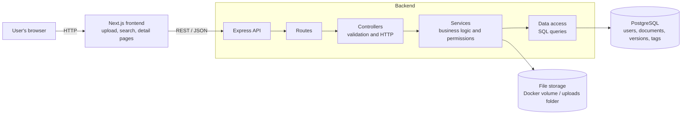

# Architecture

## System diagram

## Request flow (upload)

1. The user fills in the upload form in Next.js (file, title, tags, optional department restriction).
2. The frontend sends a `multipart/form-data` request to `POST /api/documents`.
3. The API validates the input (required fields, allowed file type, size limit).
4. The service saves the file to disk and, in one database transaction, inserts the document, its first version and its tags.
5. The API responds with the created document, or a 400 error if validation failed.

## Design choices

- **Separate frontend and backend.** Next.js handles the UI only and the Express API owns the business logic, so each can be changed or scaled independently.
- **Layered backend (routes → controllers → services → data access).** Each layer has one job, which keeps the code easy to read and test and follows SOLID's single-responsibility idea.
- **PostgreSQL for metadata.** The data is relational (users, documents, versions, tags), so we get foreign keys, joins, indexes on searched columns, and transactions so an upload never ends up half-saved.
- **Files on disk, metadata in the database.** Storing large files in the database slows it down. The database keeps only the file path, and the disk can later be swapped for object storage such as S3 without changing the schema.
- **Versions as separate rows.** A new version adds a row to `document_versions` and moves the document's `current_version_id` pointer, so the old version is never lost.
- **Tags as a many-to-many relation.** A `tags` table plus a `document_tags` join table lets a document have several tags (e.g. Finance and Legal) without duplicating tag names.
- **Department-based permissions.** Each document has an optional `allowed_department`. The search and download queries filter on the current user's department, and the check is enforced on the server, not just hidden in the UI.
- **Docker Compose for infrastructure.** One command starts PostgreSQL, so the project runs the same way on any machine.

## Scaling notes (what I'd do next)

- Redis to cache frequent search results
- Object storage (S3 or similar) instead of local disk
- Postgres full-text search (`tsvector`) for searching inside documents
- JWT authentication instead of the demo user switcher
- Run several API instances behind a load balancer (the API is stateless, so this works)