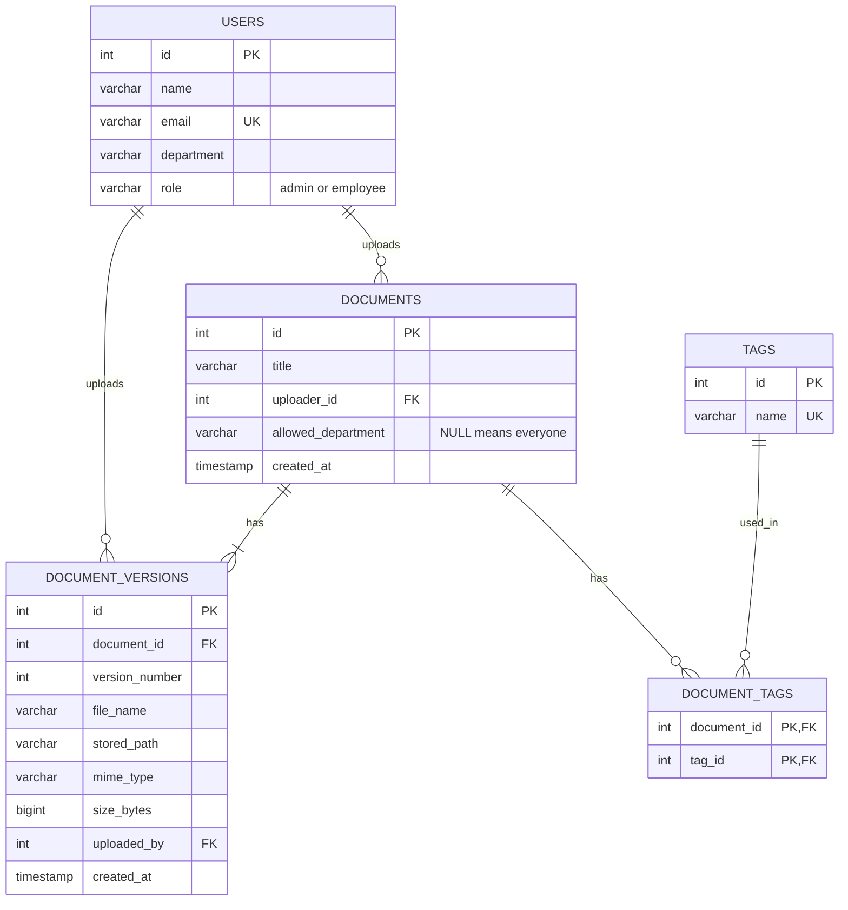

# Database design

## ER diagram

## Tables

- **users**: each user has one department (e.g. Finance, Legal, IT) and one role (`admin` or `employee`).
- **documents**: one row per logical document. It holds the title, the original uploader, and an optional department restriction.
- **document_versions**: one row per uploaded file. A new version adds a row and never overwrites an old one, so the history is kept. The current version is the one with the highest `version_number`.
- **tags** and **document_tags**: a many-to-many relation, so a document can have several tags (Finance and Legal) and a tag can belong to many documents.

## Rules

- **Versioning:** `UNIQUE (document_id, version_number)` stops two versions from sharing a number.
- **Permissions:** a user can see a document if `allowed_department IS NULL`, or it matches their department, or they are an admin. This is enforced in the SQL queries on the server.
- **Deleting:** deleting a document cascades to its versions and tag links (`ON DELETE CASCADE`).

## Indexes (on the columns we search by)

| Index | Used for |
|---|---|
| `documents(title)` | search by title |
| `documents(uploader_id)` | search by uploader |
| `tags(name)` (unique) | search by tag |
| `document_tags(tag_id)` | finding documents for a tag |
| `document_versions(document_id)` | loading the version history |

## Design notes

- Departments are stored as plain text to keep the POC simple. In production a separate `departments` table would prevent typos.
- Files are stored on disk and the database only keeps the path, so large files never slow down queries.